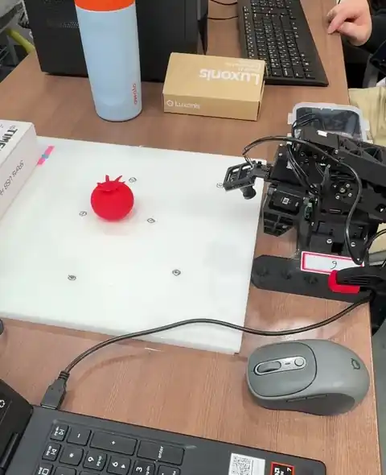
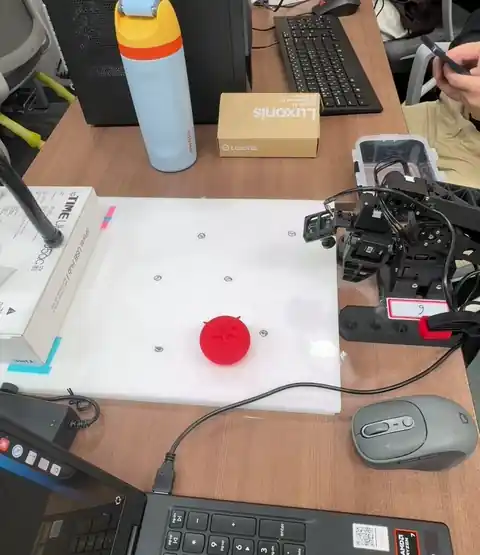

# omx-tomato-act

A ROBOTIS OMX arm picks up a tomato and puts it into a bin, using an ACT policy
trained with [LeRobot](https://github.com/huggingface/lerobot) 0.6.1 on 50
teleoperated demonstrations. This repository holds the scripts we used for
recording, training, running the policy on the real robot, and diagnosing
problems.

OMX 팔로워로 토마토를 집어 통에 넣는 ACT 정책의 녹화, 학습, 배포, 진단 스크립트 모음이다.
Physical AI 수업 실습으로 만들었다.

| | |
|---|---|
| Model | [minodori/omx_tomato_act](https://huggingface.co/minodori/omx_tomato_act) |
| Dataset | [minodori/omx_tomato](https://huggingface.co/datasets/minodori/omx_tomato) (50 episodes, 34,432 frames) |

## Demo

Real-robot rollouts with the trained model, on tomato positions it never saw
in training (between the trained positions). Filmed by hand.

| Between positions 1 and 3 | Between positions 1 and 6 |
|---|---|
|  |  |

The full-resolution videos (including position 1) are in the
[model repository](https://huggingface.co/minodori/omx_tomato_act/tree/main/assets).

## Results

Final settings: checkpoint 30,000, temporal ensembling on, start pose matched,
top camera aligned, background and chair position matched to the recording,
hands out of view. Trial counts are small; treat them as anecdotal.

| Tomato position | Result |
|---|---|
| 1 (center) | 4 of 5 grasps; gripper lands slightly right of the tomato (under 20 mm) |
| 3 | grasp and place succeeded, about 10 mm right |
| 4 | 3 of 3, about 10 mm right |
| 5, 6 | succeeded, almost no offset |
| untrained points between 1-3 and 1-6 | succeeded |

## What mattered on the real robot

The model reproduces the recorded motion very well in offline checks, but on
the real robot it is sensitive to differences from the recording setup.

- **Start pose.** A hand-placed home pose that differed from the demos caused
  a swing of about 5 degrees at the start. `scripts/omx_pos.py` shows how far
  each joint is from the demo start pose.
- **Top camera position.** A few pixels of shift changed where the gripper went.
  `scripts/omx_cam_align.py` overlays a recorded first frame on the live camera
  and shows the pixel shift, so you can put the camera back.
- **Background in the top image.** A hand in view, the cable route, and the
  right-hand background pushed the target 10 to 30 mm to the right. Keep them
  as in the recording.
- **Temporal ensembling.** Without it the arm jumps at every action-chunk
  boundary (chunk 100 = 3.3 s at 30 fps). It needs a GPU (about 15 ms per
  inference on an RTX 5060 Laptop, about 200 ms on CPU, too slow for 30 fps).
  It smooths the jumps but is not the cause of the offsets.

## Hardware and software

- ROBOTIS OMX follower and leader arms, two USB cameras (top, wrist), 640x480 at 30 fps, MJPG
- Ubuntu 24.04, RTX 5060 Laptop 8 GB, Python 3.12
- LeRobot 0.6.1: `uv pip install -e ".[training,feetech,dynamixel]"`

## Scripts

All scripts assume this repository is at `~/Projects/lerobot_lab` with the
LeRobot checkout and virtualenv at `~/Projects/lerobot_lab/lerobot/.venv`.
Edit the paths at the top of each script if yours differ.

| Script | What it does |
|---|---|
| `omx_teleop_cam.sh` | Teleoperate with both cameras and check the setup |
| `omx_record.sh N [resume]` | Record N more episodes (one position per call), or continue with `resume` |
| `omx_train.sh` | Train ACT; continues from the last checkpoint if there is one |
| `omx_rollout.sh [step]` | Run the policy on the follower (`TE=1` turns temporal ensembling on) |
| `omx_replay.sh EPISODE` | Replay a recorded episode, to tell hardware problems from model problems |
| `omx_pos.py` | Read joint positions and compare them with the demo start pose (read only) |
| `omx_cam_align.py` | Overlay a recorded frame on the live top camera (read only) |
| `omx_live_cmp.py` | Compare model outputs for recorded and live inputs (read only) |
| `omx_profile.py` | Read or write motor profile acceleration and velocity |
| `hf_push_dataset.py` | Upload the dataset to the Hugging Face Hub |
| `act_colab.ipynb` | Smoke test of ACT training on free Colab |

Typical order:

```
bash scripts/omx_record.sh 10            # position 1, then 10 more per new position with `resume`
STEPS=30000 bash scripts/omx_train.sh
TE=1 bash scripts/omx_rollout.sh         # last checkpoint; add a step number to pick one
```

Run the robot with one hand under the follower wrist and the other on Ctrl+C.
The follower torque turns off when a script ends and the arm drops.

## Setup notes

- **Serial ports.** The scripts use `/dev/omx_follower` and `/dev/omx_leader`.
  Create them with a udev rule; see [docs/99-omx.rules.example](docs/99-omx.rules.example).
- **Cameras.** `/dev/video` numbers change on every boot, and both of our cameras
  report the same serial number, so the scripts use USB port paths
  (`/dev/v4l/by-path/...`). Check yours with `ls -l /dev/v4l/by-path` and edit
  the `TOP` and `WRIST` lines in the scripts. A laptop's built-in camera also
  shows up there.
- **GPU.** Running the policy at 30 fps with temporal ensembling needs a GPU.
- **Motors.** Our follower elbow (ID 13) once stopped with an overload error;
  loosening the horn screw fixed it. Keep an eye on it.

## License

Apache-2.0
